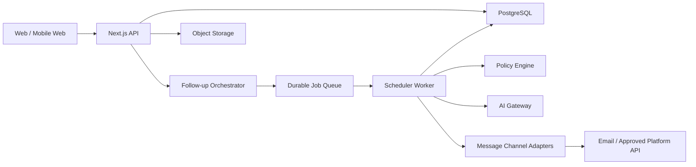

# 技术架构

## 1. 架构目标

系统优先保证不重复发送、不错过停止信号、可解释和可审计。模型只负责提取与生成，是否创建任务、何时执行和能否发送由确定性业务规则控制。

## 2. 目标组件

当前 M1C 在统一异步仓储契约下支持两种实现：未配置 `DATABASE_URL` 时使用 Node.js SQLite，数据库文件默认位于 `.data/followup.db`；配置后使用 PostgreSQL 连接池。账号、成员关系和会话均已持久化，每个账号创建独立工作区。

## 3. 代码边界

- `src/domain`：纯业务规则，不依赖 React、数据库或模型 SDK。
- `src/components`：产品界面和交互状态。
- `src/data`：初始化本地工作区所需的演示数据。
- `src/server`：共享业务记录准备、SQLite/PostgreSQL 仓储、数据库迁移、密码哈希、会话、输入验证和 HTTP 错误边界。
- `src/app/api`：认证、健康检查、工作区、机会、追问和设置接口。
- `tests`：跨页面浏览器冒烟测试。

## 3.1 当前 API

- `GET /api/health`：数据库就绪检查。
- `POST /api/auth/register`：创建账号、隔离工作区和会话。
- `POST /api/auth/login`：验证密码并轮换为新的会话令牌。
- `POST /api/auth/logout`：撤销数据库会话并清除 Cookie。
- `GET /api/auth/session`：读取最小化的当前账号 DTO。
- `GET /api/workspace`：读取当前会话所属工作区快照。
- `POST /api/opportunities`：创建机会及首次追问计划。
- `PATCH /api/follow-ups/:id`：记录发送、延后或跳过。
- `PATCH /api/settings`：保存求职目标和追问规则。

除健康检查和认证入口外，业务接口都必须先验证数据库会话，再从成员关系解析工作区。客户端不能指定或切换工作区 ID。

## 3.2 认证与会话

- 密码使用 Node.js scrypt、随机盐和恒定时间比较，数据库不保存明文密码。
- 浏览器保存 256 位随机不透明令牌；数据库只保存 SHA-256 摘要。
- 会话 Cookie 为 HttpOnly、SameSite=Lax、Path=/，生产模式启用 Secure，默认 30 天过期。
- 登录失败对不存在账号和错误密码使用相同响应，并执行等价的密码派生工作。
- 退出同时删除数据库会话与浏览器 Cookie；过期会话不能读取任何业务数据。

## 3.3 数据库适配

- `FollowUpStore` 定义页面与 API 使用的异步数据契约。
- SQLite 适配器复用本地同步仓储，保持零配置开发体验。
- PostgreSQL 适配器使用连接池和原生参数化 SQL；账号创建、机会创建、设置更新和追问变更均使用事务。
- 工作区读取在同一连接的 `REPEATABLE READ READ ONLY` 事务中完成，避免机会、追问和设置来自不同快照。
- 追问变更使用 `SELECT ... FOR UPDATE`，相同发送记录保持幂等。
- 迁移使用事务级 advisory lock，支持多个应用实例同时启动。
- 共享纯函数生成示例记录、首次追问和状态变化，避免两个数据库实现出现业务规则分叉。

## 4. 核心数据实体

### Opportunity

包含用户、公司、岗位、阶段、渠道、招聘方、使用简历和当前状态。所有阶段变化写入不可变时间线。

### ConversationEvent

保存消息方向、渠道、原始文本、发生时间和结构化提取结果。原始内容与模型推断分开存储。

### FollowUpTask

保存计划时间、触发规则、追问次数、状态、草稿版本和幂等键。任务状态至少包含 `scheduled`、`awaiting_approval`、`sending`、`sent`、`cancelled` 和 `failed`。

### CandidateMemory

保存事实内容、作用范围、来源、置信度、有效期和版本。敏感字段单独加密。

### AuditEvent

记录创建、编辑、确认、发送、取消和记忆变更。审计记录只追加，不覆盖。

## 5. 可靠发送

队列允许至少一次执行，因此发送路径必须幂等：

1. Worker 使用 `follow_up_task_id + draft_revision` 生成幂等键。
2. 数据库事务将任务从 `approved` 原子更新为 `sending`。
3. 渠道适配器携带幂等键发送；支持原生幂等的渠道直接复用。
4. 成功后记录渠道消息 ID 并更新为 `sent`。
5. 超时重试前先根据幂等键和渠道消息 ID 检查已有结果。

建议使用 PostgreSQL outbox，避免业务事务成功但队列消息丢失。

## 6. 模型边界

模型可以：

- 从对话中提取承诺日期、阶段和缺失信息。
- 根据已确认事实生成草稿。
- 标注不确定性并请求用户澄清。

模型不可以：

- 直接决定是否允许发送。
- 绕过最大追问次数和终态规则。
- 创建不存在的个人经历、薪资或到岗承诺。
- 直接写入长期记忆；记忆变更需要验证和版本记录。

提示词、模型版本和结构化输出 schema 必须进入版本控制。每次变更运行固定行为评测集。

## 7. 安全与隐私

- 生产环境采用行级租户隔离，所有查询必须携带用户 ID。
- 简历文件使用私有对象存储和短时签名 URL。
- 静态数据、备份和高敏感字段加密。
- 日志不记录完整简历、手机号、邮箱和消息正文。
- 用户支持导出、删除和撤销渠道授权。
- 自动发送能力按用户、渠道和消息类型分别授权。

## 8. 可观测性

至少监控：任务逾期量、队列延迟、生成失败率、确认率、发送失败率、重复发送拦截次数、回复后未取消任务数。高风险异常需要立即告警并支持关闭渠道发送的全局开关。
